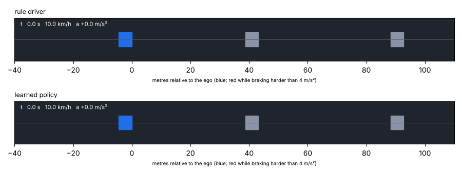
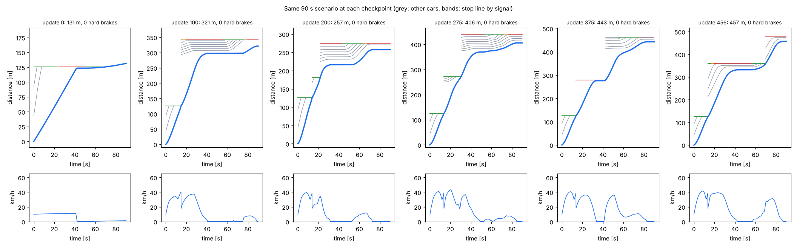
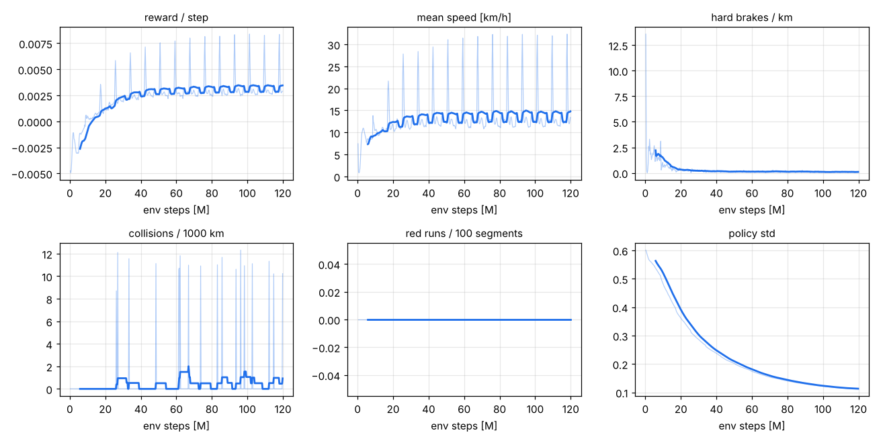
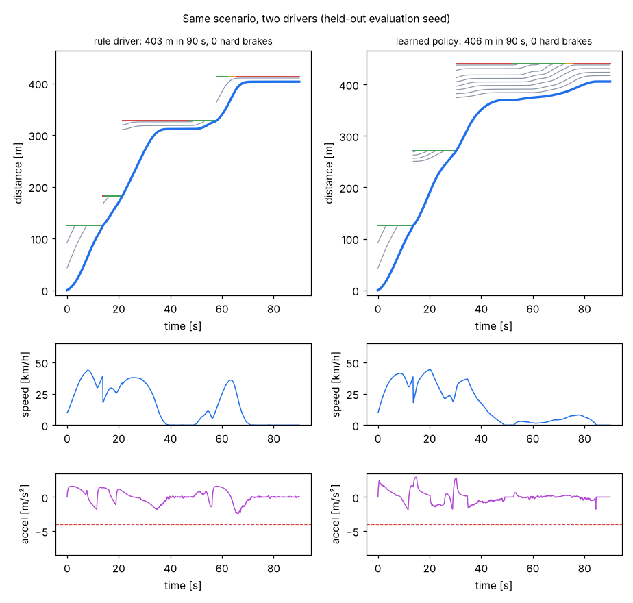
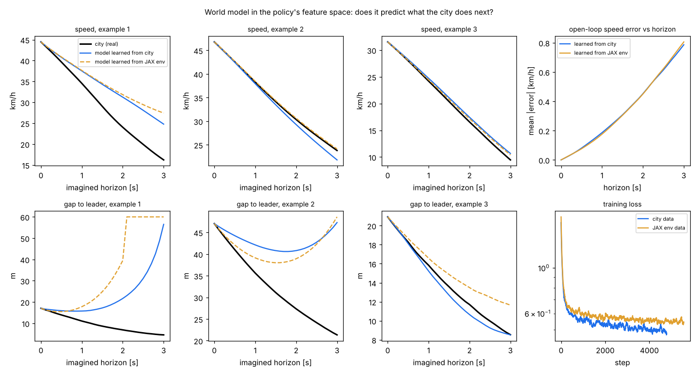
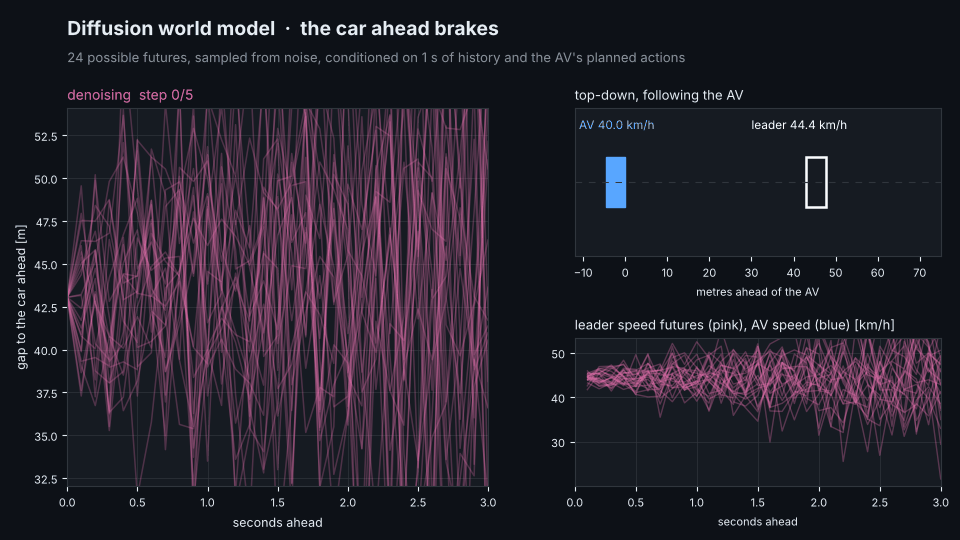

# av_world_rl

A **pure-JAX driving environment** that mirrors one AV inside [`small_av_world`](https://github.com/haggler3/small_av_world),
a **PPO** trainer with live visuals, the export path that runs the learned policy **inside the Rust AV stack**
(`small_av_world` and [`small_av`](https://github.com/haggler3/small_av)'s `rust/` crate), and a first **learned world model**
trained on transitions logged in the city.

Why longitudinal only: inside the city the AV never changes lane. It follows the car ahead, stops for red lights and full
junction exits, and is handed over to the next segment. Yet the Rust stack decided all of that with an 80-candidate Frenet
sampling planner, which was **75-97 % of the AV's CPU time** and the source of most of its hard braking (25 hard
brakes per city trip). Here a small MLP (22 → 64 → 64 → 1) learns that job instead. The LQR lane keeping, LiDAR, perception,
tracking and EKF stay exactly as they were.



## Results

### In the city (`small_av_world`, Rust, the learned policy vs the original planner stack)

| | planner stack | learned driver (in its safety envelope) |
|---|---|---|
| CPU per AV step, full LiDAR pipeline | 20.1 µs | **5.0 µs (4.0x)** |
| CPU per AV step, oracle perception | 13.2 µs | **2.0 µs (6.6x)** |
| 64 trips (8 seeds × 4 routes × 2 peaks) vs an ordinary IDM driver, paired | -0.04 min (SE 0.40) | **-1.00 min (SE 0.41)** |
| … arrived / collisions / red-light runs | 64 / 0 / 0 | 64 / 0 / 0 |
| … hard brakes (> 4 m/s² above 3 m/s) per trip | 25.5 | **0.5** |
| fleet, 5 % AVs, morning peak: AV trip / hard brakes per AV-hour | 8.53 min / 87.5 | **8.30 min / 1.5** |
| … collisions / red-light runs / min clearance | 0 / 0 / 0.78 m | 0 / 0 / 1.18 m |

### Mixed autonomy (fleet, seed 1, 10 simulated hours, AVs from 07:18; cohort = trips requested 07:30-09:00)

| | planner, 30 % AVs | learned, 30 % AVs | learned, 100 % AVs |
|---|---|---|---|
| cohort mean trip: human cars / AVs | 10.67 / 10.54 min | **10.11 / 9.45 min** | – / **8.62 min** |
| gridlock teleports (whole day) | 82 | 14 | 7 |
| AV collisions / red-light entries | 1 / 8 | 1 / 8 | 2 / 36 (in 15,492 AV trips) |
| hard brakes per AV-hour | 94.8 | **2.3** | 3.3 |
| AV compute, 4 cores (AV-seconds per wall-second) | 7,486 | **13,673** | 22,030 |
| wall time for the 10 h day | 390 s | **202 s** | 454 s |

**100 % AVs no longer gridlock the city.** With the planner stack, `small_av_world` reported gridlock at 100 % (vehicles on
the road climbing past 3,300 and still rising at 10:00; human-only cohort on this seed: 13.4 min). With the learned driver
the peak is ~1,240 vehicles and the cohort averages 8.6 min. Fleet-level compute gains (1.8x at 30 %) are smaller than the
single-AV 4x because LiDAR, perception and the world's bookkeeping now dominate. At 100 % the AV-AV interactions show:
2 collisions and 36 red-light entries (0.23 % of AV trips) - the policy was trained against IDM drivers only.

The safety envelope cut the policy's command in **0.3-0.4 % of decisions** in these runs (`learned driver: safety envelope …` in the fleet output).

### In the JAX env (held-out seeds, 1024 envs × 205 s)

| driver | km/h | hard brakes / km | collisions / 1000 km | red runs / 100 segments | blocked junction entries / 100 segments | envelope acts |
|---|---|---|---|---|---|---|
| rule: IDM follower + stop-line governor | 13.9 | 0.146 | 0 | 0 | 0 | 0.14 % |
| **learned, inside the envelope** | **14.3** | **0.077** | 1.2 | 0 | 0 | 0.12 % |
| learned, envelope switched off | 14.3 | 0.055 | 10.8 | 0.42 | 0.72 | 0 |

The last row is why the envelope stays: the policy alone is smooth and fast but has a small rate of stop-line and spacing
errors that PPO did not train away (see *What it took* below).

## How it works

```
 avrl/env.py      one AV on a road segment, fixed shapes, jax.vmap over thousands of copies
                  ├─ up to 8 IDM vehicles ahead (the world's driver distributions, trucks, yellow-runners), a reacting follower
                  ├─ the world's signal timing, entry-room rule, hand-over speed cap, stalled vehicles, cross traffic filling the exit
                  ├─ what the AV really sees: 2 Hz world snapshots extrapolated at constant velocity, 60 m range,
                  │  tracks that start at vx = 0 after every junction, confirmation delay, noise
                  └─ reward: progress − comfort − hard braking − jerk − short headway − speeding − envelope use;
                     collisions, red runs, blocked junctions and waiting past the line are penalised
 avrl/ppo.py      PPO in pure JAX (plain weight arrays → easy Rust export); one jitted function per update
 avrl/viz.py      live training curves, time-space diagrams of a fixed scenario at every checkpoint, comparison GIF
 avrl/export.py   policy.json + parity vectors for Rust, .npz for NumPy
 avrl/worldmodel.py  ensemble MLP world model in the policy's feature space, trained on city transitions
```

On the Rust side (`src/av/learned.rs` in both repos) the agent builds the same 22 features from its confirmed tracks and the
world snapshot, runs the MLP at 10 Hz, caps the result with the envelope (`shield_bound`: an IDM stop 1 m before the line
when a stop is required, a tight IDM bound behind the leader, the speed limit), and follows a straight lane-centre path with
the existing LQR. Tests check the Rust forward pass and envelope against JAX on exported vectors.

## Run it

```bash
pip install -r requirements.txt                       # on a T4: pip install "jax[cuda12]" optax matplotlib pillow
export JAX_DEFAULT_PRNG_IMPL=unsafe_rbg               # much cheaper random numbers (they were the bottleneck)
python -m avrl.ppo --steps 120e6 --envs 4096 --out results/final      # ~9 min on 4 CPU cores
python -m avrl.compare results/final/policy.npz --out results/final    # metrics table, comparison figure, GIF
python -m avrl.export results/final/policy.npz --world ../small_av_world
python -m pytest -q tests                              # 8 tests, ~1 min

# in small_av_world
cargo test --release --test learned_policy
cargo run --release -- av-bench --driver learned
cargo run --release -- trips --seeds 8 --driver learned
cargo run --release -- fleet --driver learned --share 0.3 --start 0 --hours 10 --av-from 7.3 --cohort-start 7.5 --cohort-end 9.0
```

Throughput: the env alone runs ~400k steps/s on this 4-core CPU at 4096 envs; PPO end to end ~220k steps/s. Two things
made it fast: one `jax.random.uniform` call per step (sliced), and pre-sampling each env's next segment / next episode once
per rollout (`Spare`), because sampling a fresh segment cost ~40x a physics step. On a T4 expect several times more; use
`--envs 16384` or more there.

## Training visuals

Every `--viz-every` updates the trainer redraws `training_curves.png` and drives the **same 90 s scenario** with the current
policy, adding a time-space diagram to `learning_progress.png` (time → x, distance → y; grey = other cars, thick blue =
the AV, horizontal bands = stop lines coloured by the signal). You can watch it go from crashing, to standing still, to
driving through queues and lights.





The periodic spikes in the speed curve are an artefact: all envs start their 2048-step episodes together, so every ~8 M
steps a batch of fresh episodes begins at once.

## A world model from the city

`small_av_world` can log every learned-driver decision (`AV_TRANSITIONS=file cargo run --release -- fleet --driver learned …`):
the 22 features and the action, at 10 Hz. `avrl/worldmodel.py` trains a 3-member ensemble MLP on (obs, action) → next obs
(continuous deltas, flags, signal state) and compares it with the same model trained on JAX-env transitions, on held-out
city vehicles.

| (828k city transitions, 167 AVs; 20 % of the vehicles held out) | model trained on city data | model trained on JAX-env data |
|---|---|---|
| one-step error: gap to leader (m, ×50) / leader speed (m/s, ×15) | 0.0099 / 0.0039 | 0.0089 / 0.0051 |
| signal state / stop-required flag accuracy | 99.5 % / 99.0 % | 99.5 % / 99.0 % |
| open loop 3 s, while following: speed error / gap error | 0.79 km/h / 8.1 m | 0.81 km/h / 7.7 m |



Honest reading: the pipeline works, but this first model is **not yet better than the hand-written env** at predicting the
city, and its 3-second gap error is too large to train a policy inside it ("dreaming"). With the first policy and before
the env modelled the world's 2 Hz snapshots, the city-trained model was clearly ahead (3.4 m vs 6.3 m gap error at 3 s);
after that env fix the two are equal. So today it is a **sim-to-world gap meter** (re-run it after any env change). It fails
mostly when the AV closes on a slowing queue: from the AV's features alone the leader's next move is not predictable, and
open-loop errors compound. Next steps that would make it a real simulator: condition on a short history, train with a
multi-step rollout loss, and model the vehicles ahead (positions/speeds) rather than the policy's derived features.

## What it took (and what is still wrong)

Each version was trained, exported and driven through the city; every fix came from the city's collision / red-light logs.

| version | change | city result that drove the next change |
|---|---|---|
| v1 | first reward | 64 trips 1.6 min faster than ordinary drivers, 0.1 hard brakes/trip, but 1 collision, 5 red runs: it **sped** (19.6 m/s on 16.7 m/s roads, outside the LQR's gain table) and dithered on yellow |
| v2 | speed-limit penalty, yellow decision latched at onset, blocked junction entry −15 | 64 trips: 0 collisions, 0 red runs; 30 % fleet: 18 collisions, 9 red runs: AVs crept past the line into full junctions (the env teleported them through; the world does not) |
| v3 | no hand-over without permission (red / full exit), penalty for waiting past the line, 2 Hz snapshots in the env | most AV-side contacts were now at walking pace: it parked within 0.2 m of the car ahead |
| v4 | standstill-gap penalty; hand-over checked only every 0.5 s like the world | worse: many AVs stuck past the line (reverted the 0.5 s check) |
| v5 | 5 m "don't block the box" margin, go on yellow only if the line is < 2.3 s away | in the env still worse than the rule driver at stop lines: PPO plateaued with residual errors |
| **v6** | **classical safety envelope around the policy, in training and deployment** | results above; one 64-trip run had a trip stuck > 30 min in spill-back → deploy margin 2 m |

Still wrong or missing:
* The envelope is part of the system: the learned policy alone is not safe enough (table above).
* The shipped policy was trained with a 5 m junction-room margin and is deployed with 2 m (5 m lost its place in
  spill-back queues: 30+ min vs 26.6 for the planner on one trip); 0 m was faster still, but blocks junctions more.
* 1.2 collisions per 1000 km remain in the env (the rule driver: 0), and a few red-light entries per city run at 30 % share.
* Trained only against IDM drivers: other AVs (which brake differently and are seen through 2 Hz snapshots) are the hardest case at high shares.
* Longitudinal only, one lane, no pedestrians: it covers exactly what the city asks of the AV, not `small_av`'s pedestrian or cut-in scenarios (the planner still handles those there).
* One training seed per version; the city comparisons are paired but 64 trips cannot resolve differences much below 1 min.

## Layout

```
avrl/       env.py, ppo.py, baselines.py, evaluate.py, compare.py, viz.py, export.py, worldmodel.py, viz_wm.py
tests/      env physics and rules, determinism, safety envelope, PPO update
results/    final/ (policy.npz, log.csv, compare.json, figures), wm/ (world model results and weights)
docs/img/   figures used here
```

## A diffusion world model of the city (`dwm/`)

A separate model: given 1 s of an AV's history (all 22 features) and its next 3 s of planned actions, it samples many
possible 3 s futures of speed, distance to the line, leader visibility, gap, leader speed and the must-stop flag.
It is trained on 1.08 M windows from 693 AVs logged in `small_av_world` (10 % share, morning peak), split by vehicle.

The key design choice is a **physics residual**: the AV's own motion is almost fully determined by its actions, so a
kinematic model (actions through the vehicle model, leader at constant speed) predicts it and diffusion only learns how the
world deviates from it, which is mostly what the car ahead does.

**Final run** (`python -m dwm.train --budget 450 --cfg '{"sample_steps": 5}'`): 549 s end to end on 4 CPU cores (load,
22,100 training steps, evaluation), 1.1 M-parameter MLP denoiser, v-prediction, 5 DDIM steps, 0.06 ms per sampled future.
On 4,000 held-out windows (CRPS; lower is better):

| | kinematic | constant velocity | diffusion world model |
|---|---|---|---|
| gap to leader at 1 s / 3 s | 0.34 / 1.62 m | 0.31 / 1.55 m | **0.13 / 0.33 m** |
| leader speed at 3 s | 0.87 m/s | 0.87 m/s | **0.19 m/s** |
| AV speed at 3 s | 0.039 m/s | 1.18 m/s | **0.009 m/s** |
| real outcome inside the 90 % band (gap, 3 s) | - | - | **90.8 %** |

**Ablations** (`results/dwm/ablations.md`: 90 s each; `results/dwm/step_matched.txt`: equal training steps):
* the physics residual is essential (without it 10x worse); conditioning on the planned actions is essential; 1 s of history helps;
* v-prediction ~ x0-prediction in accuracy but x0 is over-confident (85 % coverage); eps-prediction fails at this budget;
* 5 DDIM steps is best (2 is over-confident, 20 no better); conv and a 5 M-parameter MLP are too slow to train on this CPU;
* **diffusion vs a deterministic regressor with the same network: the regressor wins at 2,500 steps (0.60 vs 0.85 skill), diffusion wins at 8,000 (0.45 vs 0.53)** and is the only one with calibrated uncertainty.



**Open problem: the sampled futures are not smooth.** The final MLP outputs 30 steps independently and its samples are
~51x rougher than real trajectories (visible in the GIF). Generating 10 control points and interpolating fixes most of it
and improves accuracy at equal steps (skill 0.36 vs 0.45, roughness 4.8x) but narrows the bands (86 % coverage). A DiT-style
attention denoiser (`net="attn"`: history and future-step tokens, adaLN, action per token) is implemented but not yet
trained or compared; the final model and the GIF above predate both fixes.

```bash
python -m dwm.data data/city10.bin data/dwm      # windows from AV_TRANSITIONS logs
python -m dwm.ablate --budget 90                  # equal-budget ablations
python -m dwm.train --budget 450 --cfg '{"sample_steps": 5}' --out results/dwm/final
python -m dwm.viz                                 # the GIF
```
