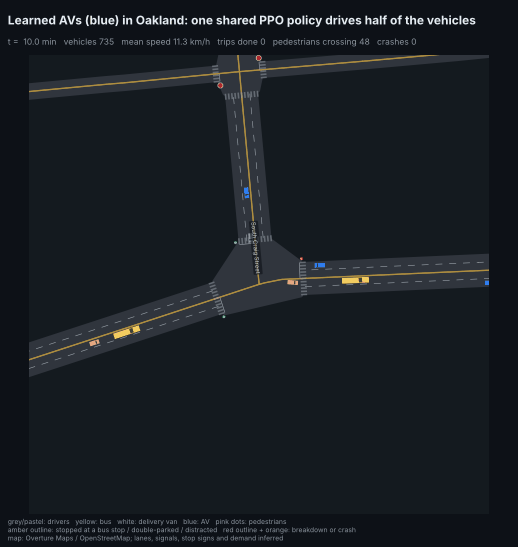
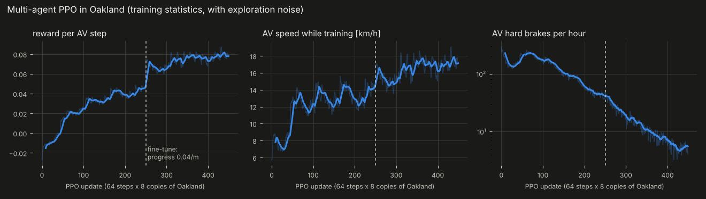

> **This repo now lives in the [`av_world`](https://github.com/haggler3/av_world) monorepo** (`avrl/`, `dwm/`, with full history). New work happens there.

# av_world_rl

Learning on top of [`small_av_world`](https://github.com/haggler3/small_av_world), the Rust city simulator:

1. **A learned driver.** A pure-JAX copy of one city road segment, PPO, and an export path that runs the policy inside the
   Rust AV stack (`small_av_world` and [`small_av`](https://github.com/haggler3/small_av)'s `rust/` crate). It replaces the
   AV's sampling planner, which was 75-97 % of its CPU time and caused most of its hard braking.
2. **Generative world models.** Diffusion and flow-matching models that sample possible 3 s futures of the traffic around an
   AV, trained on transitions logged in the city (`dwm/`).

3. **A city-area driver (new).** Multi-agent PPO in [`av_world`](https://github.com/haggler3/av_world)'s `xnet`, a whole
   simulated map area (Oakland, Pittsburgh). One shared policy drives every AV among human drivers, pedestrians,
   buses, signals and stop signs. A world model is trained on the same simulator.

The intersection and area simulators (turn lanes, risky human drivers, calibrated crash rates, OpenStreetMap areas) are
in their own repo, [`av_world`](https://github.com/haggler3/av_world).

## The city-area driver (`avrl/xppo.py`)



**What changed from the corridor driver:**

- **Environment.** The corridor env was a JAX copy of one road segment of `small_av_world`. Here the environment is the
  whole area: 313 junctions, signals and stop signs, right of way at every conflict point, lane changes, pedestrians,
  buses and double-parked vans. The humans around the AVs react to them.
- **Multi-agent, parameter-shared.** Every AV in 8 copies of the area is driven by the same policy. One simulator step
  gives about 1,000 transitions (the corridor env gave one per environment), about 23,000 transitions per second on
  4 CPU cores. GAE runs per vehicle slot with masks, and trips that end or crash cut the return.
- **Two actions.**
  - An acceleration command, capped by the same classical safety envelope as before: IDM bounds toward the stop target
    and the leader, plus the speed limit.
  - A gap-acceptance scale for the next junction (0.8-1.5x the human critical gaps), so the policy learns how
    cautiously to turn across or merge into traffic. The rule-based AV uses 1.25.
- **Richer observation (28 features).** Includes the stop target, whatever caused it (signal, stop sign, yielding,
  crosswalk, full exit), the earliest arrival on a movement with priority, turn speed caps and the wrong-lane flag.
- **Domain randomisation per copy:** AV share (15 / 40 / 100 %), demand (0.8-1.3x) and human risk (calibrated x1 / 5 / 15).
- **Training.** First behaviour cloning of the rule-based AV (60 rollouts, 2 min), then PPO. Each update (rollout of
  all copies, GAE, 4 epochs) is one jitted function of about 1.8 s. Copies are restarted in turn so jams never stick.

**Two reward problems found on the way:**

- **The first policy learned to crawl** (AV speed 5.7 -> 3 km/h). Hard-braking, headway and speeding penalties only
  apply when moving, so standing still was the cheapest. Fixed with an idle penalty (as in the corridor env), a larger
  progress reward and a small team term (the area's mean speed).
- **The next one cruised at 70 % of the desired speed on free road.** Under exploration noise, speed means more hard
  braking later. Fine-tuning with progress at 0.04/m fixed it.



*Training statistics include exploration noise. The reward jump at the dashed line is the reward change, not a jump in
skill.*

**Results** (`python -m avrl.xeval`): deterministic policy, 8 copies x 30 simulated minutes, same seeds, humans with the
calibrated risky behaviour:

| | trips | mean speed | AV trip | human trip | AV hard brakes /h | AV jerk RMS | AV near misses | AV crashes |
|---|---|---|---|---|---|---|---|---|
| humans only | 18,574 | 12.2 km/h | - | 6.41 min | - | - | - | - |
| 25 % AVs, rule-based | 18,402 | 12.2 | 6.22 min | 6.58 min | 13.3 | 2.43 | 8 | 2 |
| **25 % AVs, learned** | 18,134 | 12.0 | **6.16 min** | 6.59 min | **2.5** | **1.66** | 2 | 4 |
| 100 % AVs, rule-based | 18,200 | 12.0 | 6.30 min | (humans: none) | 12.7 | 2.43 | 15 | 12 |
| **100 % AVs, learned** | 18,203 | **12.4** | 6.35 min | | **2.3** | **1.66** | 24 | 10 |
| 25 % rule-based, humans x10 riskier | 18,457 | 12.2 | 6.24 min | 6.55 min | 13.3 | 2.42 | 6 | 2 |
| 25 % learned, humans x10 riskier | 18,458 | 12.3 | 6.26 min | 6.54 min | 2.5 | 1.67 | 8 | 3 |

**What this shows:**

- **Smoothness:** the learned driver brakes hard about 5x less often and its jerk is about 30 % lower.
- **Speed:** it is as fast as the rule-based AV (AV trips within 1 %), and with 100 % AVs the whole area is slightly
  faster (12.4 against 12.0 km/h).
- **Safety: no evidence of a difference either way.** No AV ran a red light. Crash and near-miss counts are small
  (2-24) and go both ways. Many of the crashes are the area simulator's own residual crashes (see `av_world`), so they
  cannot separate the two drivers.
- **Shield:** the envelope changes 2 % of the decisions.

The policy uses the new 28-feature observation, so it does not run in the Rust `small_av_world` stack (that needs the
corridor driver below).

**World model on the same simulator** (`dwm/xnet_data.py`, `DWM_SOURCE=xnet`):

- **Data:** 2.8 M AV decisions logged from 15 simulated minutes of 4 copies, driven by a learned-policy checkpoint
  (`results/xnet2`) with its exploration noise. That gives 920 k windows of 1 s history and 3 s future at 5 Hz.
- **Models:** the same diffusion models as `dwm/`, unchanged; the data spec is switchable.
- **Results** (skill = error relative to the kinematic model, lower is better):

| | skill | gap CRPS at 3 s | 90 % coverage of the gap | roughness vs real | sampling |
|---|---|---|---|---|---|
| kinematic (physics) | 1.0 | 1.84 m | - | - | - |
| diffusion, per-step output (4 min) | **0.70** | 1.73 m | 92 % | 21x | 0.09 ms / future |
| diffusion, DCT basis (3 min) | 0.72 | **1.48 m** | 85 % | **2.6x** | **0.06 ms / future** |

The DCT model is the one to use: as accurate, with far smoother futures, and faster to sample. Against physics it is a
smaller gain than in `small_av_world` (0.72 against 0.32). Here the leaders are signal- and right-of-way-driven traffic
through junctions, not one segment's queue.

```bash
pip install -e ../av_world && (cd ../av_world && python -m pgh.fetch)     # the area simulator and its map data
python -m avrl.xppo --out results/xnet --updates 250                        # BC + PPO (~9 min on 4 CPU cores)
python -m avrl.xppo --out results/xnet3 --updates 200 --init results/xnet/policy.npz --reward '{"progress": 0.04}'
python -m avrl.xeval results/xnet3/policy.npz                               # the table above (~7 min)
python -m avrl.xviz                                                         # training curves, street-view GIF
python -m dwm.xnet_data results/xnet3/policy.npz                            # world-model data (the run above used results/xnet2)
DWM_SOURCE=xnet python -m dwm.train --data data/dwm_xnet --budget 180 --out results/dwm/xnet_dct \
    --cfg '{"basis": "dct", "nb": 6, "sample_steps": 5}'
```

## The corridor driver and the city world models (`small_av_world`)


### Headline results

**Learned driver in the city** (Rust, against the original planner stack):

| | planner stack | learned driver |
|---|---|---|
| CPU per AV step (LiDAR / oracle perception) | 20.1 / 13.2 µs | **5.0 / 2.0 µs** |
| 64 benchmark trips vs an ordinary driver (paired) | -0.04 min | **-1.00 min** (SE 0.41) |
| collisions / red-light runs / hard brakes per trip | 0 / 0 / 25.5 | 0 / 0 / **0.5** |
| 30 % AVs, morning peak: AV / human trip time, hard brakes per AV-hour | 10.5 / 10.7 min, 94.8 | **9.5 / 10.1 min, 2.3** |
| 100 % AVs | gridlock | **flows** (8.6 min average trip) |

The policy runs inside a classical safety envelope (it changes about 0.3 % of decisions); without it the policy alone has
10.8 collisions per 1000 km in the env. At 100 % AVs it had 2 collisions and 36 red-light entries in 15,492 trips: it was
trained against human-like drivers only.

**World models** (3 s futures, on the 64-trip benchmark; skill = error relative to a physics model, lower is better):

| | trips with the driver it was trained on | trips with the planner stack (unseen driving style) |
|---|---|---|
| diffusion, 30 steps (7.5 min of training) | **0.32** | 2.83 |
| flow matching, DCT basis (4k steps) | 0.38 | 2.14 |
| diffusion, leader-physics decoder (4k steps) | 0.44 | **1.06** |

With the driver they were trained on, all models beat physics by 2-3x. With a different driver only the physics-structured
model holds up: a world model trained on one policy's data does not transfer to another.

## Quick start

```bash
pip install -r requirements.txt                 # on a GPU: pip install "jax[cuda12]" optax scipy matplotlib pillow
export JAX_DEFAULT_PRNG_IMPL=unsafe_rbg         # much cheaper random numbers on CPU

python -m avrl.ppo --steps 120e6 --envs 4096 --out results/final        # train the driver (~9 min on 4 CPU cores)
python -m avrl.compare results/final/policy.npz --out results/final      # metrics, figures, GIF
python -m avrl.export results/final/policy.npz --world ../small_av_world # weights + parity vectors for Rust
python -m pytest -q tests

python -m dwm.gifs2d                            # train diffusion and flow world models (~5 min), 2D GIFs
python -m dwm.benchmark                         # score them on the 64-trip benchmark

# in small_av_world
cargo run --release -- trips --seeds 8 --driver learned
cargo run --release -- fleet --driver learned --share 0.3 --start 0 --hours 10 --av-from 7.3 --cohort-start 7.5 --cohort-end 9.0
```

## 1. The learned driver (`avrl/`)

Inside the city the AV never changes lane, so the decision is one-dimensional: how hard to accelerate. `avrl/env.py` copies
one road segment of the world as a fixed-shape JAX function (IDM traffic with the world's driver mix, signals, the
junction-entry rule, 2 Hz world snapshots, tracker quirks), so thousands of copies run under `jax.vmap` (about 400k steps/s
on 4 CPU cores). `avrl/ppo.py` trains a 22 → 64 → 64 → 1 MLP; `avrl/export.py` writes it into the Rust crate, where tests
check the forward pass and the envelope against JAX. The trainer draws live curves and a time-space diagram of a fixed
scenario at every checkpoint:


It took six versions to get safe; every fix came from the city's collision and red-light logs ([`docs/HISTORY.md`](docs/HISTORY.md)).

## 2. World models (`dwm/`)

Given 1 s of an AV's history and its next 3 s of planned actions, the models sample possible futures of its speed, the gap
to the car ahead, the leader's speed and the stop-line state. The key design choice is a **physics residual**: the AV's own
motion follows from its actions, so the models only learn how the world deviates from a kinematic prediction.

| | |
|---|---|
|  |  |

What the experiments showed (all tables in [`docs/WORLD_MODELS.md`](docs/WORLD_MODELS.md)):
* the physics residual and conditioning on the planned actions are essential;
* diffusion beats a deterministic regressor with the same network once trained long enough, and gives calibrated uncertainty;
* smooth output bases (DCT) fix jagged samples; flow matching beats diffusion at equal training;
* all models are over-confident on short budgets, and none transfers to a driving style it never saw.

## Documentation

* [`docs/METHODS.md`](docs/METHODS.md): pipelines and math (the MDP, PPO, the safety envelope, diffusion, flow matching, bases, CRPS)
* [`docs/HISTORY.md`](docs/HISTORY.md): the six versions of the learned driver and what is still wrong
* [`docs/WORLD_MODELS.md`](docs/WORLD_MODELS.md): every world-model experiment, ablation and benchmark table

## Layout

```
avrl/       driving env, PPO, baselines, evaluation, visuals, export, one-step world model
avrl/xppo.py, xeval.py, xviz.py   the city-area driver: multi-agent PPO in av_world's xnet, evaluation, figures
dwm/        diffusion / flow world models: data (DWM_SOURCE=city | xnet), model, bases, training, ablations, benchmark, GIFs
dwm/xnet_data.py   world-model data logged from the area simulator
tests/      env rules and physics, determinism, safety envelope, PPO update; xnet RL hook, shield, multi-agent PPO
results/    final/ (the corridor policy), xnet/ xnet2/ xnet3/ (area policies; xnet3 is the final one), dwm/ (world models, incl. xnet/ and xnet_dct/), wm/
docs/       METHODS.md, HISTORY.md, WORLD_MODELS.md, img/
```
