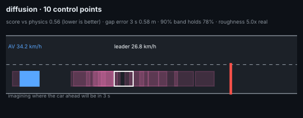
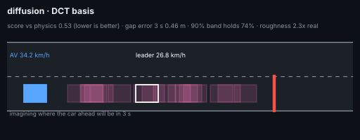
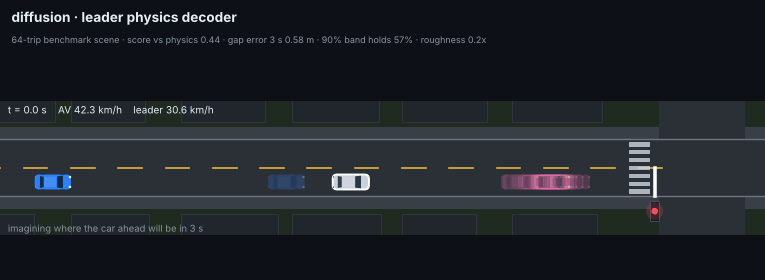
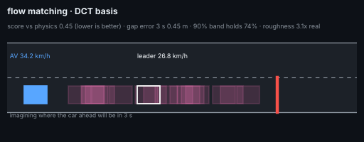

# World models: all experiments

## 1. One-step world model in the policy's feature space (`avrl/worldmodel.py`)

`small_av_world` can log every learned-driver decision (`AV_TRANSITIONS=file cargo run --release -- fleet --driver learned …`):
the 22 features and the action, at 10 Hz. `avrl/worldmodel.py` trains a 3-member ensemble MLP on (obs, action) → next obs
(continuous deltas, flags, signal state) and compares it with the same model trained on JAX-env transitions, on held-out
city vehicles.

| (828k city transitions, 167 AVs; 20 % of the vehicles held out) | model trained on city data | model trained on JAX-env data |
|---|---|---|
| one-step error: gap to leader (m, ×50) / leader speed (m/s, ×15) | 0.0099 / 0.0039 | 0.0089 / 0.0051 |
| signal state / stop-required flag accuracy | 99.5 % / 99.0 % | 99.5 % / 99.0 % |
| open loop 3 s, while following: speed error / gap error | 0.79 km/h / 8.1 m | 0.81 km/h / 7.7 m |


Honest reading: the pipeline works, but this first model is **not yet better than the hand-written env** at predicting the
city, and its 3-second gap error is too large to train a policy inside it ("dreaming"). With the first policy and before
the env modelled the world's 2 Hz snapshots, the city-trained model was clearly ahead (3.4 m vs 6.3 m gap error at 3 s);
after that env fix the two are equal. So today it is a **sim-to-world gap meter** (re-run it after any env change). It fails
mostly when the AV closes on a slowing queue: from the AV's features alone the leader's next move is not predictable, and
open-loop errors compound. Next steps that would make it a real simulator: condition on a short history, train with a
multi-step rollout loss, and model the vehicles ahead (positions/speeds) rather than the policy's derived features.


## 2. Diffusion and flow-matching world models (`dwm/`)

A separate model: given 1 s of an AV's history (all 22 features) and its next 3 s of planned actions, it samples many
possible 3 s futures of speed, distance to the line, leader visibility, gap, leader speed and the must-stop flag.
It is trained on 1.08 M windows from 693 AVs logged in `small_av_world` (10 % share, morning peak), split by vehicle.

The key design choice is a **physics residual**: the AV's own motion is almost fully determined by its actions, so a
kinematic model (actions through the vehicle model, leader at constant speed) predicts it and diffusion only learns how the
world deviates from it, which is mostly what the car ahead does.

**Final run** (`python -m dwm.train --budget 450 --cfg '{"sample_steps": 5}'`): 549 s end to end on 4 CPU cores (load,
22,100 training steps, evaluation), 1.1 M-parameter MLP denoiser, v-prediction, 5 DDIM steps, 0.06 ms per sampled future.
On 4,000 held-out windows (CRPS; lower is better):

| | kinematic | constant velocity | diffusion world model |
|---|---|---|---|
| gap to leader at 1 s / 3 s | 0.34 / 1.62 m | 0.31 / 1.55 m | **0.13 / 0.33 m** |
| leader speed at 3 s | 0.87 m/s | 0.87 m/s | **0.19 m/s** |
| AV speed at 3 s | 0.039 m/s | 1.18 m/s | **0.009 m/s** |
| real outcome inside the 90 % band (gap, 3 s) | - | - | **90.8 %** |

**Ablations** (`results/dwm/ablations.md`: 90 s each; `results/dwm/step_matched.txt`: equal training steps):
* the physics residual is essential (without it 10x worse); conditioning on the planned actions is essential; 1 s of history helps;
* v-prediction ~ x0-prediction in accuracy but x0 is over-confident (85 % coverage); eps-prediction fails at this budget;
* 5 DDIM steps is best (2 is over-confident, 20 no better); conv and a 5 M-parameter MLP are too slow to train on this CPU;
* **diffusion vs a deterministic regressor with the same network: the regressor wins at 2,500 steps (0.60 vs 0.85 skill), diffusion wins at 8,000 (0.45 vs 0.53)** and is the only one with calibrated uncertainty.


**Smoother futures (`python -m dwm.quick`, 6.4 min end to end on a 200k-window sample):** the model above generates 30
steps independently and its samples are ~51x rougher than real trajectories. Generating 10 control points and
interpolating fixes most of that. In a 60 s head-to-head on the sample, the 10-control-point MLP reached skill 0.55; a small
DiT-style attention denoiser (`net="attn"`, 64x2) only managed 800 steps on this CPU and was far behind (2.5): inconclusive,
it needs a GPU or a longer budget. The MLP trained for 3 min (12,900 steps) is the model in the GIF:

| (800 held-out windows) | kinematic | 30-step model (above) | 10 control points (`results/dwm/quick`) |
|---|---|---|---|
| skill vs kinematic | 1.0 | 0.33 | 0.43 |
| gap CRPS at 3 s | 1.62 m | 0.33 m | 0.32 m |
| roughness vs real trajectories | - | ~51x | **4.2x** |
| 90 % band coverage (gap, 3 s) | - | 91 % | 84 % (somewhat over-confident) |

**Architecture experiments (`python -m dwm.explore`, 60 s of training each on the 200k sample, 800 held-out windows; `results/dwm/explore/`):**

| output representation | skill vs kinematic | gap CRPS 3 s | 90 % coverage | roughness vs real | best possible (projection floor) |
|---|---|---|---|---|---|
| control points, 10 per channel | 0.56 | 0.54 m | 81 % | 4.9x | 0.05 m |
| **DCT, 8 cosines per channel** | **0.50** | **0.45 m** | 72 % | 2.3x | 0.30 m |
| leader physics decoder (leader acceleration integrated into speed and gap), ridge encoder | 0.53 | 0.52 m | 52 % | **0.21x** | 0.34 m |
| … same with a plain pseudo-inverse encoder | 2.10 | 8.0 m | 99 % | 81x | 0.18 m |

What was learned:
* **DCT is the best output basis at this budget**: most accurate and nearly as smooth as reality.
* **The physics decoder needs a regularised encoder.** It is ill-conditioned (condition number 3e6): with a pseudo-inverse,
  0.1 of latent noise became 55 m of gap error. With ridge 1e-4 that drops to 0.18 m (5x less than knots or DCT) and its
  futures are the smoothest, but at 60 s it is the most over-confident.
* **Did not help:** classifier-free guidance on the actions (1.0 / 1.5 / 2.5 all slightly worse), adding measurement noise
  as an observation model (std-scaled: far worse; robust-scaled: no change), stochastic sampling (eta 0.5 / 1, 10 steps:
  coverage unchanged, `sampler.txt`).
* **Open:** the compact bases are over-confident at 60 s (52-81 % coverage for a 90 % band). The 30-step model reached 91 %
  only after 22k steps, so the next test is a longer DCT run.

**Flow matching vs diffusion, and a 2D GIF per model (`python -m dwm.gifs2d`, 5 min: 60 s of training each, same 800 windows):**
rectified flow (`kind="flow"`) uses the same network but learns a velocity field that carries noise straight to a future,
sampled with 10 Euler steps.

| model | skill vs kinematic | gap CRPS 3 s | leader speed CRPS 3 s | 90 % coverage | roughness vs real |
|---|---|---|---|---|---|
| diffusion, 10 control points | 0.56 | 0.58 m | 0.28 m/s | 78 % | 5.0x |
| diffusion, DCT | 0.53 | 0.46 m | 0.25 m/s | 74 % | 2.3x |
| diffusion, leader physics decoder | 0.54 | 0.55 m | 0.29 m/s | 49 % | 0.21x |
| **flow matching, DCT** | **0.45** | **0.45 m** | **0.24 m/s** | 74 % | 3.2x |

At this budget flow matching is the best model so far: same network, same data, better skill than diffusion with the
same basis (0.48 vs 0.53 at an equal 4,000 steps).

**On the original `small_av_world` benchmark** (`python -m dwm.benchmark`): the 64 trips of `av_world trips --seeds 8`
(4 routes x 2 peaks x 8 seeds), logged once with the learned driver and once with the **original planner stack** driving.
The world models were trained only on a 10 % fleet run with the learned driver, so the planner-driven trips test whether
they generalise to a different driving style. Skill vs the kinematic baseline (lower is better; < 1 beats physics):

| model | trips, learned driver: skill / gap CRPS 3 s / 90 % coverage | trips, planner stack: skill / gap CRPS 3 s / 90 % coverage |
|---|---|---|
| kinematic (physics) | 1.00 / 1.98 m / - | 1.00 / 1.70 m / - |
| diffusion, 30 steps (full data, 7.5 min) | **0.32** / **0.34 m** / 89 % | 2.83 / 5.41 m / 31 % |
| diffusion, 10 control points (4k steps) | 0.42 / 0.50 m / 87 % | 1.88 / 3.74 m / 52 % |
| diffusion, DCT (4k steps) | 0.43 / 0.47 m / 82 % | 1.85 / 3.08 m / 53 % |
| diffusion, leader physics decoder (4k steps) | 0.44 / 0.58 m / 57 % | **1.06** / **1.45 m** / 42 % |
| flow matching, DCT (4k steps) | 0.38 / 0.44 m / 85 % | 2.14 / 3.35 m / 56 % |

* **Same driver, new trips:** every world model beats physics, by 2-3x on the gap 3 s ahead; the bigger diffusion model is best,
  flow matching is best among the 4k-step models, and coverage is close to nominal here (82-89 %).
* **Different driver (the planner stack):** all purely learned models are *worse than physics* (1.9-2.8x) and over-confident.
  A world model trained on one policy's data does not transfer to another policy: the planner keeps different gaps, brakes
  harder and stops elsewhere, so the history it sees is out of distribution. Only the **leader physics decoder** holds up
  (1.06, at parity with physics, best gap error), because its structure (gap and leader speed integrate one leader
  acceleration) constrains what it can imagine. The fix is data from several driving policies (planner, learned, human-like).

Top-down on a benchmark scene (blue: the AV; pink: 16 imagined leaders; silver: the real car ahead; the AV approaches a red light):

| | |
|---|---|
|  |  |
|  |  |

Pipeline and math for everything here (PPO, the envelope, diffusion, flow matching, the bases, CRPS): [`METHODS.md`](METHODS.md).

```bash
python -m dwm.data data/city10.bin data/dwm      # windows from AV_TRANSITIONS logs
python -m dwm.ablate --budget 90                  # equal-budget ablations
python -m dwm.train --budget 450 --cfg '{"sample_steps": 5}' --out results/dwm/final
python -m dwm.quick                               # small fast pass: compare, train 3 min, redraw the GIF
python -m dwm.explore                             # 60 s architecture experiments (bases, guidance, observation noise)
python -m dwm.gifs2d                              # diffusion bases vs flow matching (add max_steps for equal training)
python -m dwm.benchmark                           # world models on the 64-trip benchmark, planner and learned driver; 2D car GIFs
```
